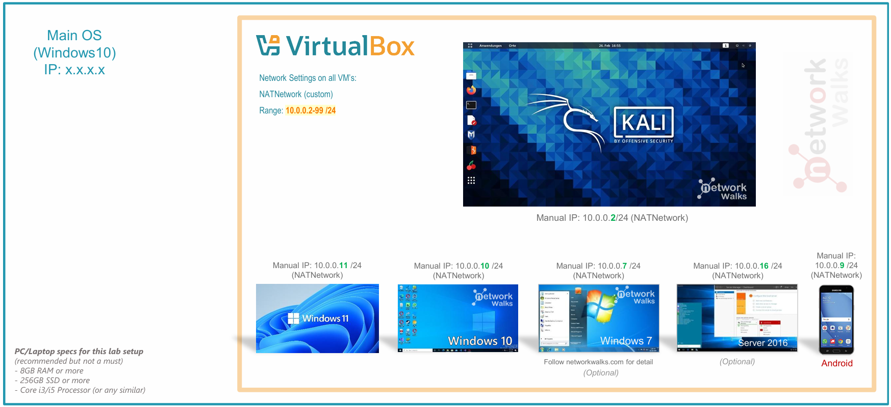
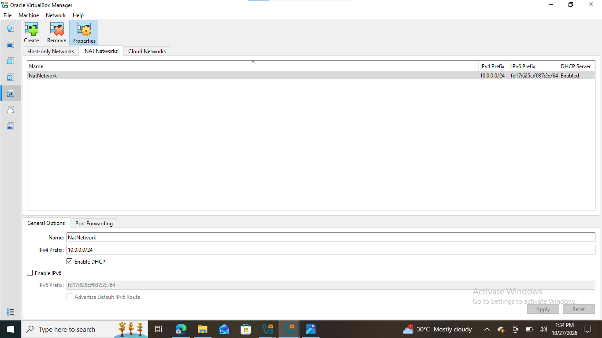
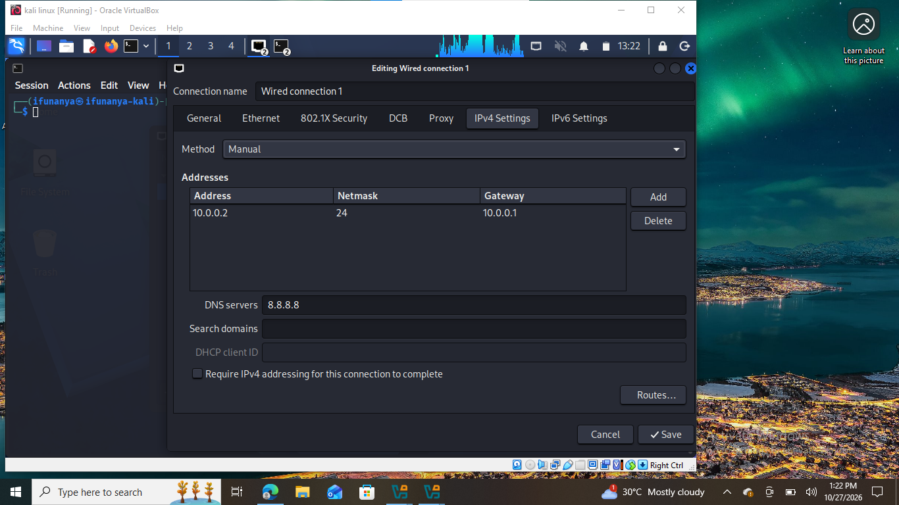
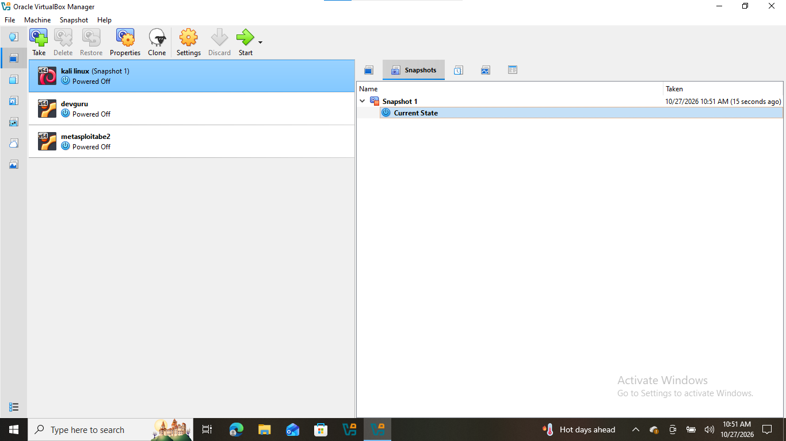

# networkwalks-B083C-week1-Cybersecurity-Lab-Setup

Cybersecurity lab setup

First steps of creating a virtual lab for pen testing and ethical hacking.

## Project Overview

For Week 1 of the Cyber Securtiy Internship held by network walks I have setup a virtual lab on Kali Linux via Oracle Virtual Box.

The lab is a controlled environment to practice and develop ethical hacking and penetration testing, and other security skills.

It is configured on a private NAT network in order to accommodate more machines later on.

## Objectives

- Install Oracle VirtualBox.
- Install Kali Linux.
- Import Kali Linux on the virtual machine.
- Create a private NAT Network for the cybersecurity lab.
- Configure and verify network connectivity for Kali Linux.
- Create a snapshot for current clean setup/state on the VM.
- Create a configured and protected lab environment for practice.

## Purpose of the Lab

A clean lab environment that's protected and configured for practical use.

It can be used for activities such as:

- Network reconnaissance
- Port scanning
- Vulnerability assessment
- Packet analysis
- Web security testing
- Exploitation practice
- Security-tool experimentation

⚠️ **Important:** This laboratory must only be used for systems that you own or have explicit permission to test. Do not use the lab or its tools to attack unauthorized systems.

## 🏗️ Lab Architecture

Additional target machines can be added to the same virtual network in future projects.

## Lab Setup

### Step 1. Install 7-Zip

7-Zip was already installed to extract the Kali Linux virtual-machine package, which may be distributed as a .7z archive.

Tool: 7-Zip

### Step 2. Install VirtualBox

VirtualBox was installed as the hypervisor.

### Step 3. Create the NAT Network

A dedicated NAT Network was created in VirtualBox.

Configuration:
- Network Name: NatNetwork
- IPv4 Prefix: 10.0.0.0/24
- DHCP: Enabled
- IPv6: Disabled

A NAT Network was used to create a controlled environment to keep viruses or any sort of harmful things contained.

### Step 4. Import Kali Linux

The Kali Linux virtual machine was downloaded from the official Kali Linux website and imported into VirtualBox.

The VM network adapter was configured as follows:

- Adapter 1
- Attached to: NAT Network
- Network: NatNetwork
- Adapter Type: Intel PRO/1000 MT Desktop

### Step 5. Configure the Kali Linux Network

The Kali Linux network configuration was checked and configured with a consistent IPv4 address.

Example configuration:

- IP Address: 10.0.0.2
- Subnet Mask: 255.255.255.0
- Gateway: 10.0.0.1
- DNS: 8.8.8.8

A consistent IP address makes it easier to document the lab and reference the Kali machine in future exercises.

### Step 6. Create a Clean VM Snapshot

After completing the initial configuration, a VirtualBox snapshot was created 
Example snapchotname:

The snapshot represents the clean baseline of the laboratory.

If a future exercise changes or damages the VM configuration, the machine can be restored to this baseline.

## 🔎 Lab Verification

| ✅ Test | 🧾 Command | 🎯 Expected Result |
|---|---|---|
| 🌐 Check IP address | `ip a` | Correct Kali IP displayed |
| 📡 Test gateway | `ping 10.0.0.1` | Successful replies |
| 🌍 Test Internet connectivity | `ping 8.8.8.8` | Successful replies |
| 🧰 Verify Nmap | `nmap --version` | Nmap version displayed |
| 🔄 Verify snapshot | Restore snapshot and run `ip a` | Baseline configuration restored |

### Example Results

- IP Address: 10.0.0.2/24
- Gateway: 10.0.0.1
- DNS: 8.8.8.8

## 🐞 Problem Encountered & Solutions

### Problem 1. Subnet Mismatch and DNS Setup

The VM’s address (10.0.2.3/24) and gateway (10.0.0.1) were on different subnets, so NetworkManager rejected the settings.

Solution: Set manual addressing with the lab’s values:

sudo nmcli connection modify "Wired connection 1" ipv4.method manual ipv4.addresses 10.0.0.2/24 ipv4.gateway 10.0.0.1 ipv4.dns 8.8.8.8.

then.

sudo nmcli connection up "Wired connection 1"

Result: the Internet works, and the ping to 8.8.8.8 succeeded.

## Tools & Resources

- 7-Zip: https://7-zip.org/download.html
- VirtualBox: https://virtualbox.org/wiki/Downloads
- Kali Linux: https://kali.org/get-kali

## Author

ifunanya promise internee BatchB084C

Linkedin:
https://www.linkedin.com/in/ifunanya-promise-adinde-95354140a

## Releases

No releases published

## Packages

No packages published
